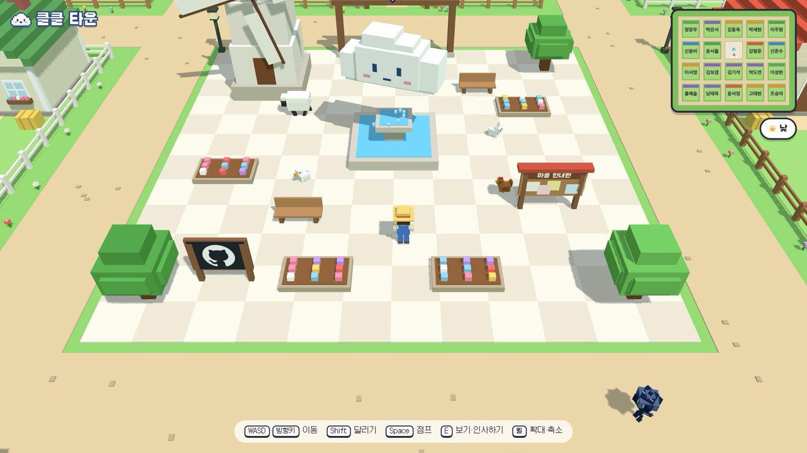

# 클클 타운 (CLCL TOWN)

**👉 [클클 타운에 놀러 가기](https://devops.ai.kr/clcl-town/)**

클클 타운은 클라우드 클럽 보드게임 TF가 함께한 게임을 기록하는 마을입니다.

## 마을에서 할 수 있는 일

- **농장 구경하기**: 친구마다 이름이 걸린 농장이 하나씩 있습니다. 농장 입구에서 E 를 누르면 농장 정보가 열립니다.
- **방명록 남기기**: 농장 정보 아래에 방명록이 있습니다. GitHub 계정으로 로그인하면 친구의 농장에 글을 남길 수 있습니다.
- **인사하기**: 농장마다 클라우드 클럽 구름이 살고, 함께한 게임이 있으면 그 게임의 캐릭터도 함께 삽니다. 가까이 가서 E 를 눌러 인사해 보세요.
- **농장 찾아가기**: 광장의 마을 안내판에서 농장 목록을 볼 수 있습니다. 이름이나 초성으로 찾은 농장으로 바로 이동합니다.
- **지도로 이동하기**: M 을 누르거나 오른쪽 위 지도를 누르면 마을 지도가 크게 열립니다. 가고 싶은 곳을 누르면 바로 그곳으로 이동합니다.
- **시간 바꾸기**: 오른쪽 위 버튼으로 아침, 낮, 저녁, 밤을 바꿀 수 있습니다. 처음 들어오면 지금 시각에 맞는 하늘로 시작합니다.

길을 걷다 보면 아직 아무 농장에도 살지 않는 수상한 인물들을 만날 수도 있습니다.

## 조작 방법

| 동작 | 키보드 | 휴대폰 |
| --- | --- | --- |
| 이동 | WASD, 방향키 | 왼쪽 조이스틱 |
| 달리기 | Shift | 조이스틱을 끝까지 밉니다 |
| 점프 | Space | 점프 버튼 |
| 상호작용 | E | E 버튼 |
| 확대·축소 | 마우스 휠 | |
| 지도 보기·이동 | M, 오른쪽 위 지도 클릭 | 오른쪽 위 지도를 누릅니다 |
| 배경음악 켜기·끄기 | P, 오른쪽 위 🔊 버튼 | 오른쪽 위 🔊 버튼 |

배경음악 볼륨은 🔊 버튼 옆 막대로 조절합니다. 화면이 버벅이면 첫 화면의 '그림자 끄기(저사양 모드)'를 켜 보세요.

## 함께 만들기

광장의 GitHub 표지판 앞에서 E 를 누르면 이 저장소로 옵니다.
농장 주인을 더하거나 함께한 게임을 기록하는 방법, 직접 실행하고 배포하는 방법은 [개발 문서](docs/DEVELOPMENT.md)에 정리해 두었습니다.

## 기술 스택

- [three.js](https://threejs.org/): 3D 복셀 마을
- [Vite](https://vite.dev/): 개발 서버와 빌드
- [giscus](https://giscus.app/): 농장 방명록 (GitHub Discussions)

## 출처와 라이선스

- 방명록 테마는 giscus 의 light 테마를 바탕으로 마을에 맞게 고쳤습니다.
- 글꼴은 [갈무리(Galmuri)](https://galmuri.quiple.dev/) 픽셀 글꼴입니다. SIL Open Font License 1.1 을 따르며, 라이선스 전문은 `public/fonts/OFL.md` 에 있습니다.
- 게임 캐릭터는 각 게임의 상자와 카드 그림을 참고해 이 마을에서 새로 만든 복셀 모델입니다.
  게임 이름과 원래 그림의 권리는 각 출판사와 작가에게 있습니다.
  - 노 터치 크라켄 (코리아보드게임즈, 일러스트 Vincent Dutrait)
  - 코드네임 (Czech Games Edition, Vlaada Chvátil)
  - 라스베가스 (alea·Ravensburger, Rüdiger Dorn)
- 머더 미스터리 캐릭터도 같은 방식으로 각 게임의 표지를 참고했습니다.
  - 웬디, 어른이 되렴 (Group SNE, 한국어판 언더독 게임즈)
  - 몇 번이고 푸른 달에 불을 붙였다, 늑대인간 마을의 축제, 용사가 죽었다 (한국어판 엠티에스 게임즈)
  - 에이다, 괴조는 깊은 탄식의 끝에 (미스터리 게임즈)
  - 서스펙트 게임: 클로즈드 서클 미스터리 (코리아보드게임즈)
